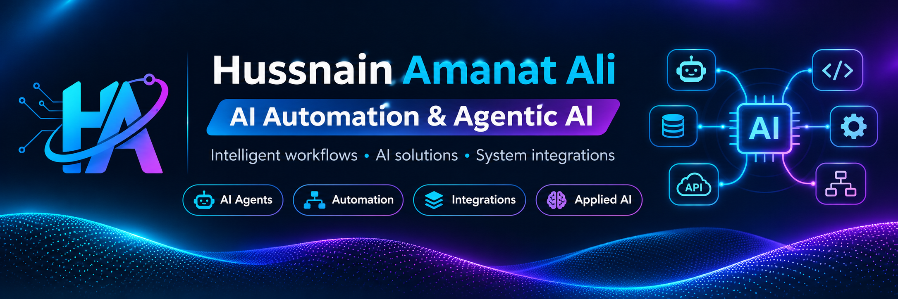
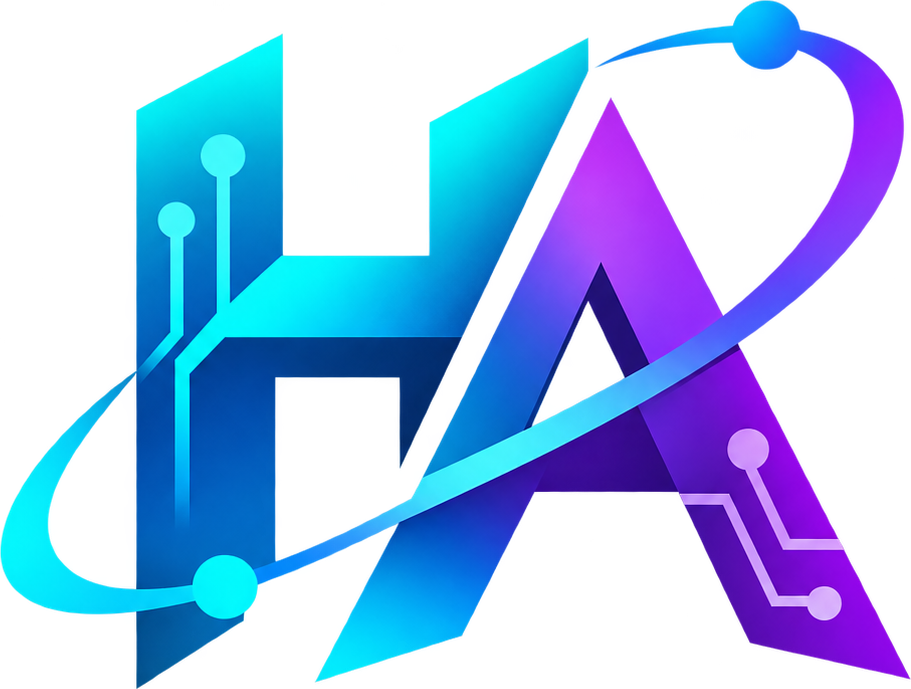

<div align="center">

  

  <p><strong>Python Developer · AI Automation Engineer · Applied AI Builder</strong></p>
  <p>Building practical software, reliable automations and intelligent products.</p>

  <a href="#-featured-projects">Featured projects</a> &nbsp;•&nbsp;
  <a href="#-engineering-toolkit">Tech stack</a> &nbsp;•&nbsp;
  <a href="https://github.com/hussnaingujjar733?tab=repositories">All repositories</a>

</div>

---

## 👋 About me

I'm **Hussnain Amanat Ali**, a developer based in **France**, specializing in **Python, backend integrations, business process automation and applied AI**. I like shipping systems that solve operational problems, not just demos.

- 🎓 MSc in **Computer Science & Data Science**, **ESILV**, France — master's studies and internship in progress.
- ⚙️ Working on professional **Python/Zoho Creator integrations, workflow automation, data validation and internal tools**.
- 🤖 Researching conversational and adaptive human–robot interaction with **EMORA-NAO** (master's thesis).
- 🏡 Building **ZAMI**, a prototype to make home-renovation decisions clearer and more trustworthy.
- 🎯 Interested in **Python software engineering, backend and AI automation opportunities**.

## 🧰 Engineering toolkit

**Backend & automation**  


**AI, data & tooling**  


## 🚀 Featured projects

| Project | Problem I'm solving | Stack / focus |
| :--- | :--- | :--- |
| 🏡 **[ZAMI](https://github.com/hussnaingujjar733/Zami)** | Helping homeowners navigate renovation quotations and decisions with more clarity and trust. **Prototype.** | Product engineering · Decision support |
| 🛡️ **[QuoteGuard AI](https://github.com/hussnaingujjar733/quoteguard-ai)** | AI-assisted review of renovation quotes to flag potential issues. **Prototype.** | Python · Applied AI · Streamlit |
| 🤖 **[EMORA-NAO](https://github.com/hussnaingujjar733/emora-nao)** | Exploring adaptive conversation and expression for NAO humanoid robotics. **Research in progress.** | Generative AI · HRI · Python |
| 🌍 **[EnviroHealth Monitor](https://github.com/hussnaingujjar733/RealTime-AirPollution-HealthRisk-Monitoring)** | Building a distributed environmental data and monitoring pipeline. **Collaborative MSc project.** | Kafka · Spark · HDFS · Grafana |
| 👁️ **[Guardian AI](https://github.com/hussnaingujjar733/guardian-ai)** | Computer-vision experimentation in detection and behavioural analysis. **Prototype.** | YOLOv8 · Computer vision |

## 🔨 Currently building

```text
PYTHON ENGINEERING
├── Business process automation and internal applications
├── API integrations and dependable validation pipelines
├── ZAMI       → Home-renovation decision-support prototype
└── EMORA-NAO  → Generative AI for human–robot interaction
```

> **Professional-project note:** Some of my work is built for an employer. Internal code, business data, customer information and private systems are not published in this profile.

## 🧭 My engineering principles

**Build for real users.** Make automation explainable and resilient. Validate before writing. Keep humans in control of consequential workflows.

---

<div align="center">
  
  <p><strong>Let's build something useful.</strong></p>
  <p>
    <a href="https://github.com/hussnaingujjar733">GitHub</a> ·
    <a href="https://github.com/hussnaingujjar733?tab=repositories">Projects</a>
  </p>
  <sub>Python • AI Automation • Backend Engineering • France</sub>
</div>
